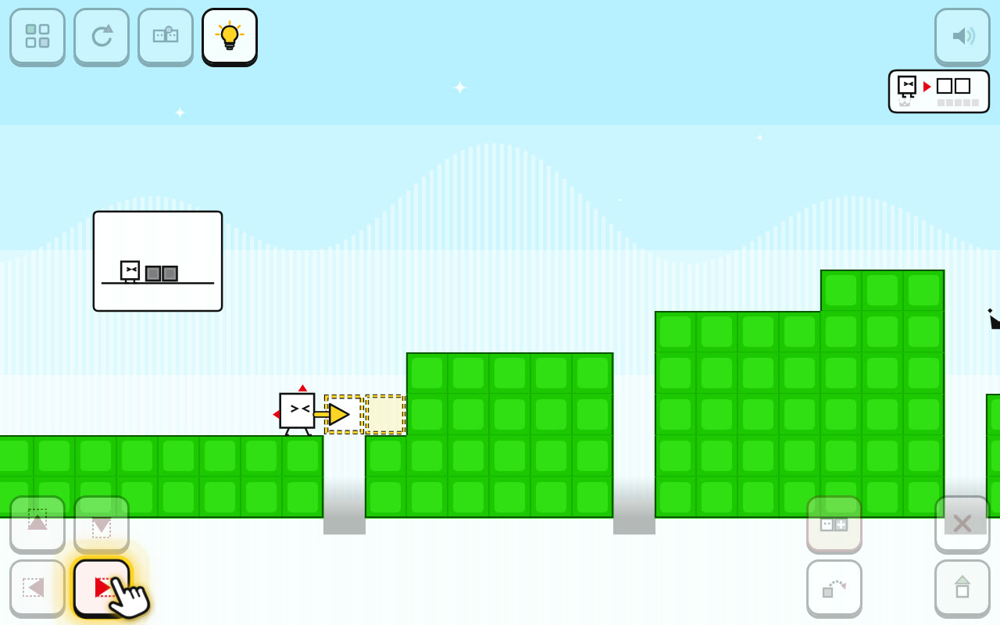

# BoxBoy! + Box Girl! — iPad Zero-Text Web Edition

**Live Playable iPad Web Game:** [https://kunruiw1991.github.io/ipad-box-boy/](https://kunruiw1991.github.io/ipad-box-boy/)

**GitHub Repository:** [https://github.com/kunruiw1991/ipad-box-boy](https://github.com/kunruiw1991/ipad-box-boy)



---

## Overview

**BoxBoy! + Box Girl! — iPad Zero-Text Web Edition** is an iPad-first, 100% Zero-Text (`alphaHanziCount === 0`) puzzle-platformer built with pure HTML5 `<canvas>` and procedural WebAudio synthesis, faithfully recreating the visual language, physics, and stage progression of the *BoxBoy! + Box Girl!* World 1 & Bonus World playthrough ([Bilibili BV1Nb411L7zi P1–P9](https://www.bilibili.com/en/video/BV1Nb411L7zi)).

Every screen, button, tutorial thought-bubble, HUD badge, and stage-clear modal uses pure geometric pictograms with zero English or Chinese text strings, zero canvas text calls (`fillText` / `strokeText`), and zero `speechSynthesis`.

---

## Guide Coach: Always Know Which Button to Press

A step-by-step, 100% graphical coach (lightbulb button, on by default) shows a young player exactly **one** thing to do at a time:

- **One glowing button**: the button to press next pulses gold with a tapping hand on it; every other button fades out.
- **A preview in the level**: a golden landing pad + dotted footsteps for walking, a dotted arc for jumps, dashed ghost boxes (with an arrow to the next one) for building, plus hook paths, slide paths with the target switch ringed, and a ring around the hero to switch to.
- **One tap per step**: tapping the glowing arrow walks the hero to the golden pad and stops there by itself; tapping the glowing jump lands exactly on the planned spot. The Create button turns into a green Drop button while boxes are held, and the arrows turn red with box outlines while building.
- **Gets you back on track**: walk the wrong way, erase the wrong box or build the wrong shape and the coach walks you back, asks you to rebuild, or (as a last resort) points at Restart. After ~6 s without progress it pulses faster and plays a soft chime.
- **Whole flow**: it also points at Play on the title screen, the next uncleared stage on the map, and Next on the Stage Clear card.
- **Fewer buttons early on**: Throw, Hook and Shoot only appear once the stage that teaches them is reached (W1S2, W1S7, W1S8). Erase is always there.

How it works: each stage's verified solution is replayed in a hidden headless engine to record a per-step trace; every frame the live game is matched against that trace. A hint-following bot that only ever taps the highlighted button clears all 12 stages from the title screen with 16/16 Crowns and 12/12 Gold Medals, and recovers from deliberate mistakes (wrong arrow, erase, walking away, restart, wrong hero).

---

## Key Features

- **Playable Heroes — Qbby & Qucy (Box Girl)**:
  - **Qbby**: Crisp white square body (`#ffffff`) with bold `3px` black outline (`#111111`), expressive dynamic eyes, and agile stubby legs.
  - **Qucy (Box Girl)**: Distinct pink/red polka-dot ribbon bow (`#ff4b72`) atop her upper-left corner with eyelash-accented eyes; playable across all stages via the top-left character toggle and featured alongside Qbby in the `W2S4` dual-character co-op finale.
- **All 6 Core Box Manipulation Mechanics**:
  1. **Extend / Draw (`Create`)**: Extrude connected orthogonal box chains (`Up`, `Down`, `Left`, `Right`) from the active hero up to the stage's `boxLimit` (`1` to `5`), with backtracking support to pop and refund the last segment.
  2. **Drop / Place (`Place`)**: Detach the extruded chain as a rigid physical structure (`#7b7d80`) that obeys gravity, bridges gaps, shields floor spikes, and blocks vertical yellow laser beams.
  3. **Throw / Toss (`Throw`)**: Toss the active chain forward in a ballistic arc onto distant ledges, narrow chasm pillars, or spike beds.
  4. **Hook / Retract (`Pull / Grapple`)**: Anchor an L-shaped or U-shaped box chain onto a high grey stone overhang and retract the chain segment-by-segment to pull the hero across chasms and up vertical shafts.
  5. **Push / Slide (`Shoot`)**: Kick a box chain horizontally across the floor or dotted phase-block bridges at high speed (`16 tiles/s`) to hit distant Blue and Red wall switches.
  6. **Erase / Recall (`Erase`)**: Dissolve active or placed boxes with a particle burst; placing a new chain automatically dissolves the hero's previous placed chain.
- **Dual-Mode iPad Touch Controls + Desktop Keyboard**:
  - **Mode A (Direct Canvas Touch Gestures)**: Drag directly from Qbby/Qucy on the `<canvas>` to extrude box chains tile-by-tile, and tap floating radial action bubbles (`Place ↓`, `Shoot ⇉`, `Hook ↰`, `Erase ✕`).
  - **Mode B (Split Ergonomic Virtual Gamepad)**: Left thumb D-Pad (`◀`, `▶`, `▲`, `▼`) and Right thumb 6-button diamond cluster (`Jump ⤒`, `Create ✚`, `Place/Throw ↓`, `Hook ↰`, `Shoot ⇉`, `Erase ✕`), all `>= 72×72 CSS px` with zero overlap across iPad Landscape (`1180×820`) and iPad Portrait (`820×1180`).
  - **Keyboard Support**: `Arrow Keys` / `WASD` (Move & Extrude; Up jumps outside build mode), `Space` (Jump / Drop), `Z` (Create / Drop), `T` (Throw), `C` (Hook / Retract), `X` (Push / Shoot), `V` / `Backspace` (Erase), `Q` / `Tab` (Switch Hero), `R` (Restart Stage), `M` (Mute), `H` (Guide Coach on/off).
- **Procedural Tactile WebAudio Synthesizer (`src/audio.js`)**:
  - Real-time oscillator and filtered noise synthesis for footsteps, jump whooshes, rising pentatonic marimba box-extrusion notes (`C5–D5–E5–G5–A5`), woody placement thuds, zippy ratchet grapples, switch chimes, laser hums, and stage-clear fanfare chords.

---

## 12-Stage Progression Guide (World 1 + Bonus World)

| Index | Stage ID | World | Box Limit | Crowns | Target Budget | Signature Mechanics & Obstacles |
| :---: | :---: | :---: | :---: | :---: | :---: | :--- |
| `0` | `W1S1` | World 1-1 | `1` | `1` | `3` | Single-box step ledges, elevated Crown plateau, animated tutorial frame |
| `1` | `W1S2` | World 1-2 | `1` | `1` | `4` | Single-box forward throw (`Throw`), mid-air Crown stand, 3-step staircase |
| `2` | `W1S3` | World 1-3 | `2` | `1` | `5` | 2-box horizontal pit bridges, narrow 1-tile chasm pillar Crown |
| `3` | `W1S4` | World 1-4 | `3` | `1` | `7` | 3-box L-staircases, recessed wall notch, cantilevered chasm bridge |
| `4` | `W1S5` | World 1-5 | `4` | `1` | `11` | Lethal floor spike beds (`spikeShield`), 4-box L-shaped Crown bridge |
| `5` | `W1S6` | World 1-6 | `3` | `1` | `10` | Vertical yellow laser emitters (`laserBlock`), cantilevered laser caps |
| `6` | `W1S7` | World 1-7 | `5` | `1` | `20` | Grey speckled stone overhangs, `Hook / Retract` grapple, chimney shaft Crown |
| `7` | `W1S8` | World 1-8 | `4` | `1` | `8` | `Push / Slide` (`Shoot`), recessed Blue/Red wall switches, dotted phase bridges |
| `8` | `W2S1` | Bonus 2-1 | `4` | `2` | `9` | Shooting box chains through vertical lasers to solidify laser-capping bridges |
| `9` | `W2S2` | Bonus 2-2 | `5` | `2` | `14` | 5-box overhang hook-grapples over floor spike pits + low-ceiling spike tunnel |
| `10` | `W2S3` | Bonus 2-3 | `4` | `2` | `11` | Twin laser bridge + 4-box cantilever slide across Red phase bridge |
| `11` | `W2S4` | Bonus 2-4 | `4` | `2` | `14` | **Qucy + Qbby Dual-Hero Co-Op Finale**: split-level switch relay, persistent partner spike bridge, overhang grapple |

---

## Programmatic Verification & Architecture

```text
.
├── index.html          # Zero-Text responsive iPad entry point & SVG touch controls
├── screenshot.jpg      # 1280x800 gameplay preview screenshot
├── README.md           # Documentation, stage table, and verification summary
└── src/
    ├── stages.js       # 12 grid-aligned stage definitions (W1S1-W2S4) & solution sequences
    ├── engine.js       # Deterministic 60fps physics, 6 box actions, co-op & window.__BOXBOY__ API
    ├── coach.js        # Guide Coach: solution-trace replay, live step tracking & recovery
    ├── renderer.js     # 100% Zero-Text HTML5 Canvas renderer (zero fillText/strokeText)
    ├── audio.js        # Procedural WebAudio synthesizer (zero speechSynthesis)
    └── input.js        # Dual-mode iPad PointerEvents, keyboard, coach highlight & guided walk/jump
```

The game exposes `window.__BOXBOY__` (`loadStage`, `getState`, `step`, `injectAction`, `runStageSolution`, `runAllSolutions`, `getHint`, `setHints`) for deterministic headless browser verification across all 12 stages.
